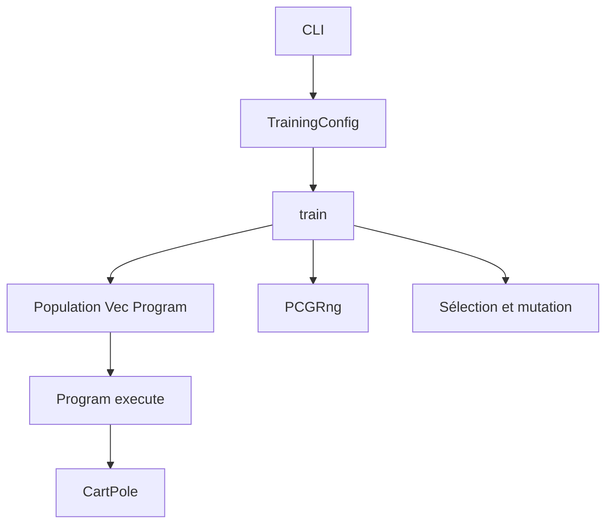
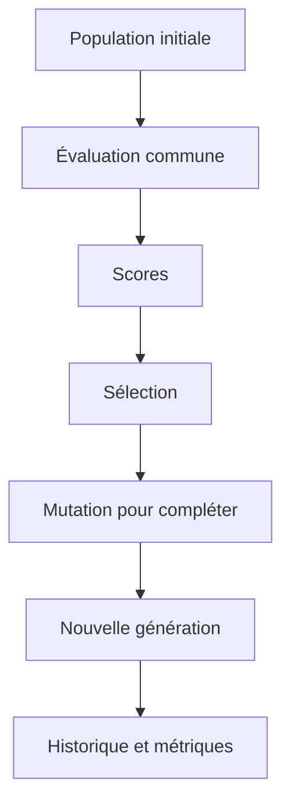

# Rapport académique — Projet prog64

## 0. Cadre et méthodes de vérification

Ce rapport présente le projet prog64 tel qu'il est réellement implémenté. Les résultats expérimentaux proviennent des fichiers JSON produits par `lgp/examples/experiment.rs`. Aucune donnée chiffrée n'est inventée. Les commandes de validation citées (`cargo fmt`, `cargo clippy`, `cargo test`) ont été réellement exécutées dans la session de travail.

Documents associés: `RESUME_EXECUTIF.md`, `GLOSSAIRE_PROG64.md`, `QUESTIONS_PROFESSEUR.md`, `PRESENTATION_ORALE_PROG64.md`, `CHECKLIST_AVANT_REMISE.md`.

# Chapitre 1 — Introduction générale

prog64 est un projet Rust composé de deux paquets (`env` et `lgp`). Il étudie l'entraînement et l'évaluation d'une entité de décision dans l'environnement CartPole. Une décision est représentée par un programme compact dans un mot de 64 bits.

La problématique est la suivante : comment stabiliser un chariot-pendule lorsque l'espace de représentation est volontairement contraint ? L'objectif principal est de réaliser une chaîne expérimentale complète : encodage, évolution génétique, évaluation par épisodes, enregistrement des résultats, contrôle de la reproductibilité et comparaison à une politique aléatoire.

La programmation génétique est adaptée à ce contexte. Elle ne fournit pas de modèle analytique explicite, mais maintient une population de programmes et les évalue par expérience dans un environnement.

CartPole représente un chariot supportant un pendule. Un programme pousse alternativement à gauche ou à droite pour éviter l'effondrement du pendule ou la sortie du chariot.

# Chapitre 2 — Définitions techniques essentielles

Chaque notion est expliquée simplement, puis de manière technique, avec un exemple tiré de prog64.

- **Algorithme** : suite finie d'étapes accomplissant une tâche. Dans `train()` : initialiser, évaluer, sélectionner, muter, recommencer.
- **Intelligence artificielle** : programme qui exécute une action utile à partir d'une information. Le `Program` choisit gauche ou droite.
- **Algorithme génétique** : optimisation fondée sur une population, une sélection et des variations. Les programmes les plus performants engendrent les suivants.
- **Programmation génétique** : les individus sont des programmes exécutables. Ici, un programme est un `u64`.
- **Programmation génétique linéaire (LGP)** : chaque programme est une séquence d'instructions linéaires agissant sur des registres et des entrées.
- **Population** : groupe courant d'individus. Dans le code : `Vec<Program>`.
- **Individu** : candidat particulier, soit un `Program`.
- **Chromosome** : ici, le mot de bits représentant l'individu.
- **Gène** : unité minimale de variation : un bit dans l'encodage.
- **Instruction** : champ de 11 bits contenant opération, destination et deux sources.
- **Génération** : cycle complet d'évaluation et de création.
- **Sélection** : conservation des meilleurs individus. Dans `select_survivors`.
- **Mutation** : variation locale par flips de bits. Dans `mutate`.
- **Élitisme** : les survivants sont copiés directement dans la population suivante.
- **Fonction de récompense** : feedback positif à chaque pas de contrôle réussi.
- **Fitness** : performance moyenne d'un programme sur plusieurs épisodes.
- **Épisode** : exécution complète depuis `reset()` jusqu'à la fin de l'épisode.
- **Environnement** : cadre contrôlant l'état et les transitions. Ici, `CartPole`.
- **Graine aléatoire** : valeur initiale déterminant le générateur PCG.
- **Reproductibilité** : mêmes paramètres et même graine donnent les mêmes résultats.
- **Diversité génétique** : variation des bits au niveau de la population.
- **Encodage binaire** : représentation des instruction par bits, masques et décalages.
- **u64** : entier non signé de 64 bits contenant l'encodage.
- **Évaluation indépendante** : essai sur 100 graines non utilisées à l'entraînement.
- **Écart-type** : dispersion des scores autour d'une moyenne.
- **Moyenne** : somme divisée par le nombre d'observations.
- **Score maximal** : 500, fixé par la limite d'épisode de CartPole.

# Chapitre 3 — Architecture logicielle

Dossiers principaux :

```text
prog64-main/
├── Cargo.toml
├── env/
│   ├── src/lib.rs
│   ├── src/cartpole.rs
│   └── src/pcgrng.rs
├── lgp/
│   ├── src/lib.rs
│   ├── src/main.rs
│   ├── examples/experiment.rs
│   └── tests/integration.rs
└── .github/workflows/ci.yml
```

Responsabilités :

- `env/src/lib.rs` : types `Score`, `State`, trait `Environment`.
- `env/src/cartpole.rs` : dynamique physique, conditions d'arrêt, stabilité terminale.
- `env/src/pcgrng.rs` : générateur pseudo-aléatoire déterministe.
- `lgp/src/lib.rs` : constantes, Program, mutation, sélection, entraînement, rapports.
- `lgp/src/main.rs` : parsing des arguments et appel à `train`.
- `lgp/examples/experiment.rs` : campagne finale et évaluation indépendante.
- `lgp/tests/integration.rs` : test complet multi-thread.
- workflow CI : formatage, clippy, tests.

Schéma :



# Chapitre 4 — Représentation des programmes sur 64 bits

Les constantes de `lgp/src/lib.rs` sont :

- `NUM_REGISTERS = 4`
- `NUM_INPUTS = 4`
- `INSTRUCTIONS = 5`
- `BITS_PER_INSTRUCTION = 11`
- `PROGRAM_BITS = 55`
- `PROGRAM_MASK = (1 << 55) - 1`

Décodage réel d'une instruction :

```rust
let opcode = ((instruction >> 8) & 0x7) as usize;
let destination = ((instruction >> 6) & 0x3) as usize;
let first = ((instruction >> 3) & 0x7) as usize;
let second = (instruction & 0x7) as usize;
```

Donc 11 bits sont répartis ainsi :

- opcode : 3 bits
- destination : 2 bits
- première source : 3 bits
- deuxième source : 3 bits

Exemple de valeur hypothétique `0b100_01_010_101`, soit `1109` :

- opcode `100` = 4 : max;
- destination `01` = 1 : registre 1;
- source 1 `010` = 2 : registre 2;
- source 2 `101` = 5 : entrée 1.

Schéma :

```text
Programme de 55 bits : [Inst4][Inst3][Inst2][Inst1][Inst0]
Instruction 11 bits  : [opcode 3 | destination 2 | source1 3 | source2 3]
```

Sources indexées comme suit :

- `0`, `1`, `2`, `3` : registres.
- `4`, `5`, `6`, `7` : entrées CartPole (le code soustrait `NUM_REGISTERS`).

Les opérations sont : addition, soustraction, multiplication, division protégée, max, min, absolue, négation. Les 9 bits de plus haut poids sont masqués. La mutation boucle sur les 55 bits et inverse un bit avec probabilité `rate`.

Le programme Best final seed 7 vaut `529822201188383`. Il est d'abord masqué pour garantir la compatibilité avec l'encodage.

# Chapitre 5 — Fonctionnement de l'algorithme génétique

Les étapes réelles sont :

1. normalisation des paramètres (`population_size`, `generations`, `episodes`, etc.);
2. initialisation de la population à partir de graines tirées du générateur;
3. génération unique des `episodes` graines d'entraînement;
4. évaluation de chaque programme;
5. calcul de la performance moyenne;
6. sélection des survivants par score;
7. création de la population suivante par clonage puis mutation;
8. historique des métriques;
9. arrêt après le nombre prévu ou par arrêt anticipé.

La sélection est fondée sur des scores triés décroissants, avec une règle de repli en cas d'ordre partiel. L'élitisme est implémenté par clonage des survivants en tête de la nouvelle population.

Paramètres de l'expérience finale :

| Paramètre | Valeur |
|---|---:|
| Population | 100 |
| Générations | 100 |
| Épisodes d'entraînement | 5 |
| Taux de survie | 0.2 |
| Taux de mutation | 0.02 |
| Arrêt anticipé | désactivé |
| Threads | 1 puis 4 |

Schéma du cycle :



# Chapitre 6 — Environnement CartPole

CartPole est défini dans `env/src/cartpole.rs`. L'état comporte `x`, `x_dot`, `theta`, `theta_dot`. Les actions possibles sont deux directions : vers la droite si l'action est strictement positive, vers la gauche sinon.

Seuils et contraintes :

- `threshold_x = 2.4`
- `threshold_theta = 12 * 2 * PI / 360`
- limite d'épisode `500`
- `force_mag = 10.0`
- `tau = 0.02`
- récompense `1.0` par pas réussi

CartPole se termine si le chariot sort de sa zone, si l'angle est trop fort ou si la durée atteint 500. Après la fin, `CartPole::step()` renvoie une valeur stable (`reward = 0.0`, `done = true`). `reset()` relance un nouvel épisode. L'état initial est généré aléatoirement avec une graine fixe.

Un programme transforme l'état en action via `execute(state) > 0.0`.

# Chapitre 7 — Fiabilité et tests

La reproductibilité est assurée par :

- un générateur PCG déterministe fondé sur la graine;
- une même liste de graines d'épisode pour chaque individu;
- une évaluation indépendante sur une autre liste de graines;
- la gestion correcte de l'état terminal.
- une exécution mono-thread et multithread cohérente;
- la sérialisation et désérialisation des résultats.

Tests réellement présents :

- `env` : 5 tests CartPole.
- `prog64` : 20 tests unitaires.
- `integration.rs` : 1 test.

Les tests couvrent l'encodage, la mutation, la normalisation, la sélection, la reproductibilité, les graines communes, l'évaluation mono et multithread et la sauvegarde.

Les commandes de validation exécutées sont :

```text
cargo fmt --all -- --check
cargo clippy --workspace --all-targets -- -D warnings
cargo test --workspace
```

Elles ont réussi.

# Chapitre 8 — Expériences réelles

La campagne utilise :

- population 100;
- 100 générations;
- 5 épisodes;
- early stop désactivé;
- graine principale 1, 7, 42;
- répétition de la seed 1;
- un essai avec 4 threads pour seed 1;
- évaluation indépendante sur 100 graines issues de la seed 10000;
- comparaison à une politique aléatoire.

Résultats d'entraînement :

| Expérience | Meilleur score | Générations | Uniques | Diversité |
|---|---:|---:|---:|---:|
| Seed 1 | 473.8 | 100 | 64 | 0.2780 |
| Seed 7 | 500.0 | 100 | 54 | 0.0886 |
| Seed 42 | 500.0 | 100 | 46 | 0.0932 |
| Seed 1 répétée | 473.8 | 100 | 64 | 0.2780 |
| Seed 1 threads 4 | 473.8 | 100 | 64 | 0.2780 |

Résultats indépendants :

| Expérience | Épisodes complets | Moyenne | Écart-type | Minimum | Maximum |
|---|---:|---:|---:|---:|---:|
| Seed 1 | 88/100 | 479.240 | 59.274 | 241 | 500 |
| Seed 7 | 100/100 | 500.000 | 0.000 | 500 | 500 |
| Seed 42 | 88/100 | 479.240 | 59.274 | 241 | 500 |
| Répétition seed 1 | 88/100 | 479.240 | 59.274 | 241 | 500 |
| Threads 4 | 88/100 | 479.240 | 59.274 | 241 | 500 |
| Politique aléatoire | 0/100 | 22.510 | 12.706 | 9 | 74 |

Les graines d'entraînement de la seed 1 sont :
`[5821722133407999884, 14879378661701511304, 11751106265427190873, 13068999408723451094, 277485609020208707]`.

Il n'y a pas de chevauchement avec les graines d'évaluation. L'expérience répétée donne exactement les mêmes scores que seed 1, et l'essai en 4 threads donne également exactement les mêmes.

# Chapitre 9 — Analyse statistique

500 est le score maximal d'un épisode. Une moyenne de 500.000 sur 100 épisodes implique les 100 épisodes à 500, donc un écart-type nul. Une moyenne de 479.240 pour seeds 1 et 42 implique un bon contrôle, mais 12 cas incomplets avec minimum 241. Les polítique aléatoire `random_bool(0.5)` obtient 22.510 avec minimum 9 et maximum 74.

La diversité binaire plus faible de seed 7 (0.0886) ne signifie pas nécessairement une faible diversité comportementale, parce que des programmes distants au niveau binaire peuvent produire un comportement équivalent, et inversement.

Les resultataus ne démontrent pas une généralisation universelle. Ils démontrent une performance sur la distribution testée.

# Chapitre 10 — Limites

- sensibilite aux graines : performances différentes selon 1, 7, 42;
- 5 épisodes d'entraînement seulement;
- limite de 55 bits et cinq instructions;
- absence de croisement;
- diversité bit n'est pas une diversité comportementale;
- evaluation sur 100 graines, mais pas sur toutes les conditions physiques possibles.

# Chapitre 11 — Perspectives d'amélioration

- augmenter la robustesse comportementale;
- comparer avec des opérateurs de mutation et la selection alternatifs;
- augmenter le nombre d'épisodes;
- évaluer davantage de graines et d'environnements;
- explorer un encodage plus expressif si nécessaire;
- étudier la diversité comportementale explicitement.

Ces pistes ne sont pas implémentées dans le projet actuel.

# Chapitre 12 — Conclusion générale

prog64 présente une chaîne complète et vérifiable : encodage compact, évolution, sélection, mutation, tests de reproductibilité, évaluation indépendante et sostenance. L'expérimentation montre qu'un programme trouvé sur seed 7 atteint 100 réussites complètes sur des graines jamais vues. Les résultats seed 1 et 42 restent nettement supérieurs au hasard. Le rapport est honnête quant aux limites.

## Tableau de synthèse des fonctionnalités

| Fonctionnalité | Implémentée | Testée | Remarque |
|---|---|---|---|
| Encodage 64 bits | Oui | Oui | tests unitaires |
| Execution | Oui | Oui | program_adds_inputs |
| Mutation | Oui | Oui | déterministe |
| Entrainement | Oui | Oui | integration |
| mono et multi thread | Oui | Oui | resultats identical |
| Serialisation | Oui | Oui | roundtrip |
| Terminal CartPole | Oui | Oui | sélection 4 tests |
| Evaluation independante | Oui | Partiellement | validation via output JSON |
| Croisement | Non | Non | absent |
| Diversite comportementale | Non | Non | future |

## annexes — extraits et schema

Extrait décoding:
```rust
let opcode = ((instruction >> 8) & 0x7) as usize;
let destination = ((instruction >> 6) & 0x3) as usize;
let first = ((instruction >> 3) & 0x7) as usize;
let second = (instruction & 0x7) as usize;
```

Extrait sauvegarde training seeds:
```rust
let training_seeds = common_episode_seeds(&mut rng, config.episodes);
let seeds_per_program: Vec<Vec<u64>> =
    vec![training_seeds.clone(); population_size];
```

Schems d'architecture et du cycle sont déjà donnés aux chapitres 3 et 5.

Fin du rapport.